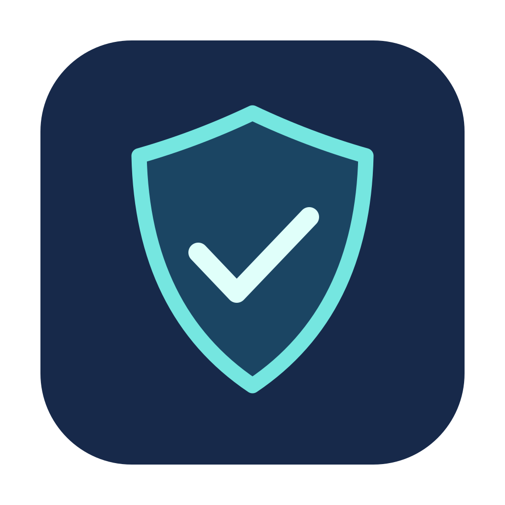
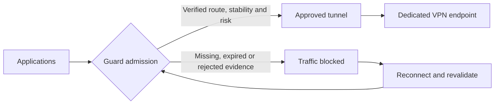

<div align="center">



# Claude Guard

**Native macOS network protection, with a clear path back online.**

[](https://github.com/Passion-Flow/Claude-Guard/releases/latest)
[](#requirements)
[](LICENSE)

[Download](#download) · [Getting started](#getting-started) · [Uninstall & recovery](#uninstall--recovery) · [How it works](#how-it-works) · [Documentation](#documentation)

</div>

Claude Guard keeps application traffic behind an approved Shadowrocket tunnel. A menu-bar panel, native dashboard, system protection, automatic route checks, exit-risk admission and local reports work together in one application. Browser, desktop, terminal and IDE traffic share the same device policy.

The interface supports **English and Simplified Chinese**, **light and dark appearance**, and system appearance. End users do not need Node, Python or terminal commands.

> **Removing the app is not a full uninstall.** Use **Claude Guard → Uninstall Claude Guard…** before an app cleaner or Trash. If the app has already been removed, use the independent offline uninstaller below. Deleting a protection component does not silently authorize direct traffic.

## Download

| File | Choose this when… |
| --- | --- |
| [Install package · PKG](https://github.com/Passion-Flow/Claude-Guard/releases/download/v1.0.1/Claude-Guard-Mac-1.0.1-private.pkg) | You want to double-click and install. |
| [Installation image · DMG](https://github.com/Passion-Flow/Claude-Guard/releases/download/v1.0.1/Claude-Guard-Mac-1.0.1-private.dmg) | You want the recovery packages and installation guide together. |
| [Independent uninstaller · PKG](https://github.com/Passion-Flow/Claude-Guard/releases/download/v1.0.1/Claude-Guard-Uninstall-1.0.1.pkg) | You need to remove Guard, including after partial deletion. |
| [Release notes & checksums](https://github.com/Passion-Flow/Claude-Guard/releases/tag/v1.0.1) | You want the validation scope and artifact hashes. |

The `private` filename identifies the **ad-hoc distribution profile**, not repository visibility. This repository is public. These packages are not Developer ID signed or Apple notarized. A local Gatekeeper **Open Anyway** action may be required; do not disable Gatekeeper or SIP.

## Requirements

- macOS 13 or later is the declared deployment target. Application and helpers are built for Apple Silicon and Intel; compilation does not establish support on every OS or vendor-client combination.
- A compatible, configured Shadowrocket installation, with **Global Routing: Proxy**, a supported encrypted profile and a dedicated numeric IPv4 server endpoint.
- Local administrator authorization for installation, recovery and removal.

Hostname bootstrap, rotating endpoints, shared/CDN nodes and arbitrary proxy clients are outside the automatic-discovery contract. See [supported profiles and limits](Docs/Installation.md#supported-discovery).

## Getting started

1. Download the **PKG**, open it and authorize installation.
2. Connect the configured Shadowrocket profile in **Proxy** mode. Allow any macOS permission prompt needed for profile discovery.
3. Wait for the dashboard to confirm protection. Setup discovers the route and checks identity, stability and risk; no required manual address, port or API-key form is shown.

Before first successful activation, a missing or unsupported VPN configuration means **protection is not active**. After activation, lost or expired admission keeps application traffic blocked while recovery and revalidation run.

| Capability | Behavior |
| --- | --- |
| Device protection | Restrictive IPv4/IPv6 policy on physical interfaces, with narrow bootstrap and DHCP exceptions. |
| Stable recovery | Application traffic waits for six successful observations spanning at least 15 seconds, plus accepted risk evidence. |
| Automatic recovery | The approved VPN service can reconnect; the signed vendor app is started after login when needed. |
| Continuous checks | Route identity, filter readback and independent health observations are separate from risk renewal. |
| Local diagnostics | Tunnel counters, bounded events, address-redacted reports and optional browser WebRTC checks. |
| Maintenance | Explicit pause, authenticated recovery and an independent offline uninstaller. |

## Uninstall & recovery

**Normal removal:** choose **Claude Guard → Uninstall Claude Guard…** in the application menu, then authorize the package in Installer. Close applications that should not reconnect directly before removing protection.

**If a cleaner has already removed the app or helpers:** open this local copy in Finder:

```text
/Users/Shared/Claude Guard Recovery/Uninstall.pkg
```

Installation creates that copy outside the app and helper directories. The [standalone release package](https://github.com/Passion-Flow/Claude-Guard/releases/download/v1.0.1/Claude-Guard-Uninstall-1.0.1.pkg) is another copy you can keep or transfer while offline. It carries its own native removal engine; installed helpers, trust metadata and internet access are not required.

Uninstall stops Guard's startup jobs and packet-rule writers, clears and verifies **only Guard's own PF anchor**, releases recorded Guard references, and removes its application, helpers, runtime state, local preferences, caches and package receipts. A short-lived task removes the uninstaller's final receipt after Installer commits it, then removes itself. Missing files are accepted; uncertain filter removal is reported as failure. Uninstall can be repeated.

It does not remove Shadowrocket, Tailscale, exported reports or downloaded archives. It does not disable the shared PF firewall or flush another application's rules. If a cleaner deleted PF-reference ownership records, unknown references are left untouched; an empty Guard anchor no longer blocks traffic. A privileged cleaner can also delete the local recovery copy, so keep a separate copy.

**Restore network** removes protection without uninstalling the app. **Pause** keeps traffic blocked. [Full maintenance guide](Docs/Installation.md#pause-recovery-upgrade-and-uninstall)

## How it works



The root supervisor owns persisted approval and coordinates the worker and packet fence. An authenticated recovery service operates separately. Component identifiers and exact code hashes are pinned in root-owned installation metadata; XPC peers authenticate before sensitive configuration is sent.

The keyless risk policy requires exact-address Proxycheck v3 residential evidence, risk at most 10 and all required detection flags false, together with the approved observed region. Provider failures cannot create a clean verdict. Existing evidence retains only its original expiry; risk renewal cannot extend route identity. [Policy and timing](Docs/Installation.md#automatic-risk-admission)

## Boundaries that matter

- **PF is shared system machinery.** This edition cannot guarantee enforcement before its startup job runs, while PF is disabled, against a root administrator, or ahead of an incompatible foreign PF rule. Repair does not erase the preceding gap. [Apple PF guidance](https://developer.apple.com/documentation/technotes/tn3165-packet-filter-is-not-api)
- **Bootstrap is address/port based.** PF cannot distinguish Shadowrocket from another process using that same permitted endpoint. Profile metadata does not prove the live cryptographic handshake.
- **The local ISP still carries the encrypted connection.** Guard does not erase physical location, establish service eligibility or guarantee account availability. Exit-risk scores are estimates.
- **Diagnostics have limited scope.** WebRTC checks apply to fresh connections in the tested browser. Anonymous service-path checks do not prove every signed-in browser or API path. Diagnostics cannot override admission.
- **Remote hosts are separate.** A development server's traffic is not covered by this Mac's policy. The optional Tailscale SSH exception has a narrow, separately documented boundary.

## Verification

Validation distinguishes **offline regressions**, **actual installed tests** and **unverified environments**. Release notes identify tested artifact hashes and completed checks; [maintenance validation](Docs/Maintenance-Validation.md) covers partial deletion and removal.

The earlier twelve-hour endurance gate was cancelled before completion and is **not represented as passed**. Historical observations remain in [Acceptance](Docs/Acceptance.md) and the [roadmap](Docs/ROADMAP.md). Another machine's results cannot prove every new installation's network behavior.

## Build & contribute

Development requires Xcode command-line tools, Python 3 and Node for the browser fixture. Application users do not need these tools.

```sh
./build.sh
python3 -I Tests/uninstall_fixture.py
python3 -I Tests/installer_fixture.py
node Tests/browser_diagnostics_test.js
```

The build produces universal binaries, checks signatures and pinned payloads, runs native diagnostics, inspects the installer and verifies the disk image. It does **not** install services or change host networking. The [CI workflow](.github/workflows/ci.yml) lists the full offline suite. Administrator-only installed acceptance scripts require explicit execution and are never shipped in the app.

Implementation and developer documentation are in English; translated user-facing text lives in localization resources. Optional Developer ID distribution uses `CODESIGN_IDENTITY`, `GUARD_TEAM_ID`, `INSTALLER_IDENTITY` and `NOTARY_PROFILE`. Signing does not change the PF boundary.

## Documentation

| Guide | Contents |
| --- | --- |
| [Installation](Docs/Installation.md) | Setup, supported profiles, risk policy, recovery and uninstall. |
| [Maintenance validation](Docs/Maintenance-Validation.md) | Removal failure cases and verification results. |
| [Privacy](Docs/Privacy.md) | Local data, diagnostic requests and report redaction. |
| [Acceptance](Docs/Acceptance.md) | Engineering checks, packet evidence and physical-test limits. |
| [Security policy](SECURITY.md) | Reporting a vulnerability privately. |
| [License](LICENSE) | MIT license. |

For ordinary bugs, [open an issue](https://github.com/Passion-Flow/Claude-Guard/issues) with the version, observed behavior and a redacted report. Do not post credentials or raw VPN profiles. Claude Guard is an independent project and is not affiliated with or endorsed by Anthropic.
